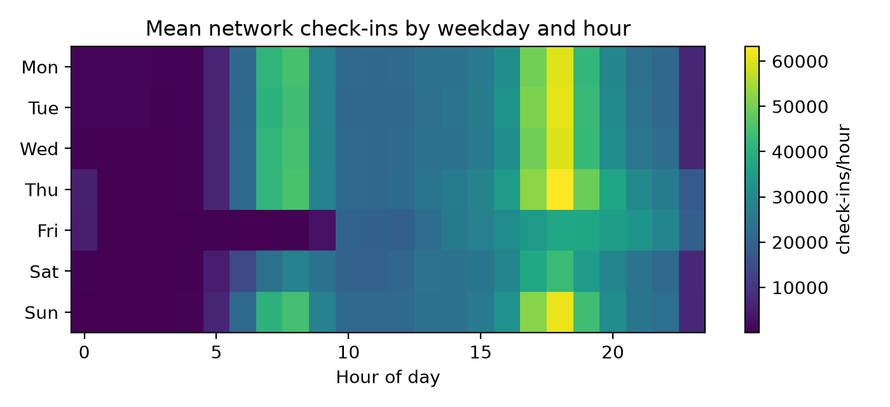
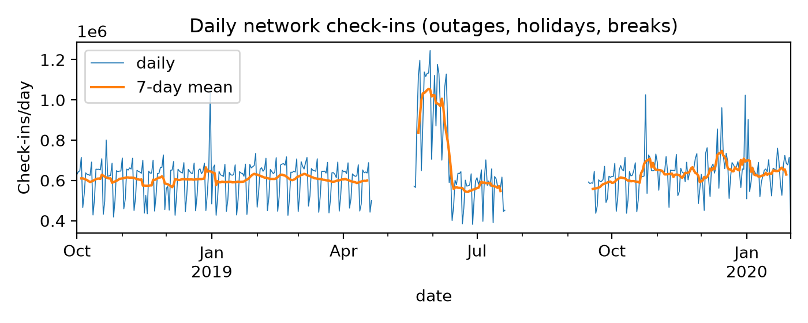
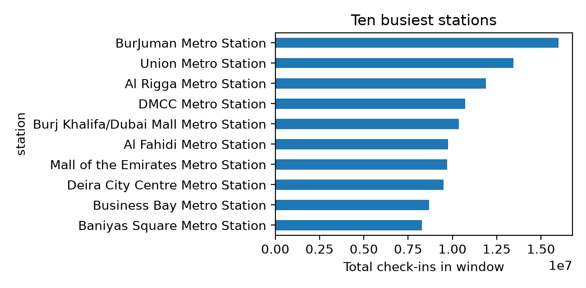
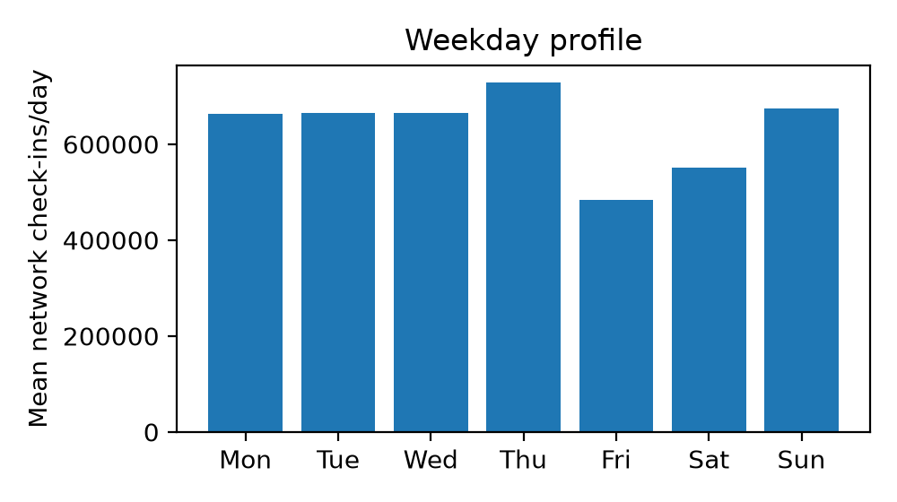
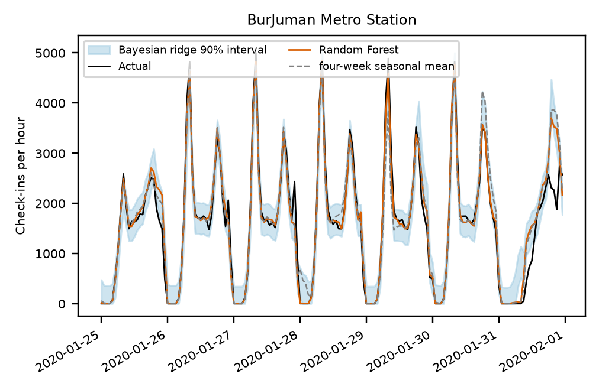
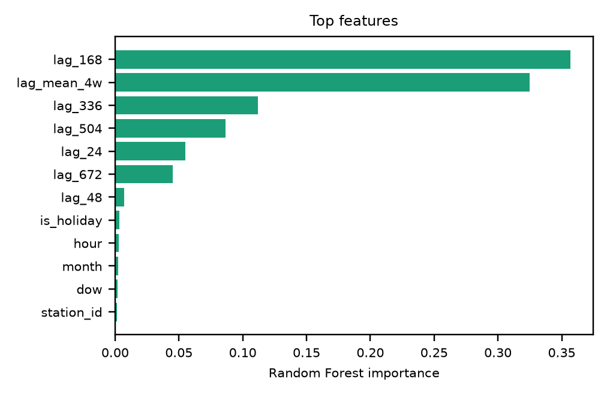

# Dubai Metro Station-Hour Demand Forecasting

## 1. Project Title and Overview

A reproducible machine-learning pipeline for forecasting hourly Dubai Metro check-in volume by station. The project transforms fare-gate transaction chunks into station-hour counts, examines data coverage and quality, engineers leakage-aware temporal features, compares six regression models with four baselines, and presents the historical test results in a local Gradio dashboard.

The evaluated task is a **rolling one-day-ahead forecast**: each prediction is for a station and hour 24 hours ahead, using lagged observations and calendar features. The saved dashboard explores a historical test set; it is not a live service or a validated current/future forecasting system.

## Table of Contents

- [1. Project Title and Overview](#1-project-title-and-overview)
- [2. Problem Statement and Objectives](#2-problem-statement-and-objectives)
- [3. Key Features](#3-key-features)
- [4. Dataset Description and Source](#4-dataset-description-and-source)
- [5. Project Directory Structure](#5-project-directory-structure)
- [6. Technologies and Libraries Used](#6-technologies-and-libraries-used)
- [7. Installation and Setup Instructions](#7-installation-and-setup-instructions)
- [8. Exploratory Data Analysis (EDA)](#8-exploratory-data-analysis-eda)
- [9. Data Preprocessing and Feature Engineering](#9-data-preprocessing-and-feature-engineering)
- [10. Model Development and Training](#10-model-development-and-training)
- [11. Model Evaluation and Results](#11-model-evaluation-and-results)
- [12. How to Run the Project](#12-how-to-run-the-project)
- [13. Sample Predictions](#13-sample-predictions)
- [14. Limitations and Future Improvements](#14-limitations-and-future-improvements)
- [15. Author and Contact](#15-author-and-contact)
- [16. License](#16-license)

## 2. Problem Statement and Objectives

Metro operators need estimates of station-level passenger activity to inform service and resource planning. This project tests whether recent station-level history and calendar patterns can improve on simple seasonal forecasts.

Objectives:

- Build a resumable pipeline to ingest and aggregate transaction chunks.
- Profile time, station, and coverage issues before selecting a modeling window.
- Forecast hourly check-ins by station while preventing temporal leakage.
- Evaluate linear, tree-based, Bayesian, and support-vector methods against transparent baselines.
- Present model performance, example predictions, and error patterns in an interactive dashboard.

## 3. Key Features

- DuckDB-backed, resumable chunk aggregation with a processed-file ledger.
- Data-quality screening for unknown times, missing dates, and unusually low-volume days.
- Station-name normalization and fallback station assignment for blank location fields.
- Lag, calendar, weekend, and public-holiday features.
- Date-ordered train, validation, and test splits with date-grouped expanding-window cross-validation.
- Six model variants and four forecasting baselines scored on the same held-out observations.
- RMSE, MAE, R², WAPE, a paired date-block bootstrap, error slices, and Bayesian interval coverage.
- EDA charts and a local Gradio app for exploring saved historical predictions by station, date, and hour.

### ML pipeline

```mermaid
flowchart LR
    A["Dubai Metro transaction chunks"] --> B["Index, download, and profile"]
    B --> C["Resumable DuckDB aggregation"]
    C --> D["Quality screen and selected date window"]
    D --> E["Station-hour counts and temporal features"]
    E --> F["Chronological train / validation / test split"]
    F --> G["Date-grouped CV and model fitting"]
    G --> H["Held-out test metrics and error analysis"]
    H --> I["Figures and local Gradio dashboard"]
```



## 4. Dataset Description and Source

The source is the Dubai Pulse / data.dubai Dubai Metro ridership dataset, identified in the downloader as **dataset ID 466403**. The acquisition script uses the [data.dubai dataset-download API](https://data.dubai/o/dda/data-services/dataset-download?datasetId=466403). Start at [data.dubai](https://data.dubai/) and verify the dataset page, access conditions, and reuse terms before distributing data or derived extracts.

The transaction fields used by the pipeline are transaction type, transaction date, transaction time, start location, and end location. The target is the number of **Check in** transactions assigned to each station and hour; it is an observed entry count, not a count of unique riders or a measure of unmet demand.

The selected modeling window is **1 October 2018–31 January 2020**, a pre-pandemic period chosen for comparatively useful hourly coverage and station consistency. The saved feature table contains **445,817 station-hour rows across 46 stations and 404 dates**. The final held-out test contains **67,344 station-hour observations** from **2 December 2019–31 January 2020**.

The latest recorded archive diagnostics report 3,119 indexed chunk files across 16 export snapshots and two older file stems in the accumulator. A chunk number appears in more than one export, so possible export overlap is unresolved. The archive-wide row totals should therefore be treated as indicative, not as a guaranteed deduplicated transaction count. The profile also reports that 55.8% of archive rows have an unknown or unparseable time; these rows cannot support hourly modeling.

Raw transaction data and most generated modeling artifacts are local and are not included in this repository. Users must obtain the source data themselves and follow its terms.

## 5. Project Directory Structure

```text
.
├── README.md
├── requirements.txt
├── src/
│   ├── 01_download.py            # Index and acquire source chunks
│   ├── 02_inspect_chunk.py       # Inspect a source chunk
│   ├── 02b_time_quality.py       # Profile time, duplicates, and station history
│   ├── 03_aggregate.py           # Build DuckDB counts and the modeling table
│   ├── aggcore.py                # Chunk parsing and DuckDB aggregation
│   ├── config.py                 # Window, grain, thresholds, and model settings
│   ├── utils.py                  # Shared normalization and metric helpers
│   ├── 04_features_baselines.py  # Features, splits, and baseline scores
│   ├── 05_eda.py                 # EDA figures
│   ├── 06_models.py              # Tune, fit, and score models
│   ├── 07_analysis.py            # Test analysis, figures, and report values
│   ├── 08_fill_report.py         # Populate a supplied Word report template
│   ├── 09_db_diagnostics.py      # DuckDB/archive diagnostics
│   ├── 10_dashboard.py           # Local Gradio results explorer
│   └── make_synthetic.py         # Synthetic data for offline pipeline checks
├── data/
│   ├── raw/                      # Downloaded chunks (local; not committed)
│   ├── interim/                  # DuckDB accumulator and aggregated counts
│   ├── processed/                # Feature table used for modeling
│   └── reference/                # Optional station reference table
└── reports/
    ├── figures/                  # EDA and model-analysis charts
    └── results/                  # Metrics, predictions, and diagnostics
```

The workflow is implemented as Python scripts; there are no Jupyter notebooks in the project.

## 6. Technologies and Libraries Used

| Technology | Use |
|---|---|
| Python | Pipeline and model implementation |
| DuckDB | Chunk-level SQL aggregation and data-quality diagnostics |
| pandas, NumPy, PyArrow | Tabular processing and Parquet input/output |
| scikit-learn | Preprocessing, cross-validation, regression models, and metrics |
| Matplotlib | EDA and evaluation visualizations |
| Requests | Dataset API and chunk downloads |
| `holidays` | UAE public-holiday feature |
| Gradio | Local interactive results dashboard

## 7. Installation and Setup Instructions

Use Python with `pip` and enough disk space for the source chunks and intermediate data. The latest saved modeling run records Python 3.14.8; dependency versions are not fully locked, so exact numerical reproducibility across environments is not guaranteed.

```bash
git clone <repository-url>
cd <repository-directory>

python -m pip install --upgrade pip
pip install -r requirements.txt
```

Raw data is not bundled. The downloader supports optional `DATA_DUBAI_TOKEN` and `DATA_DUBAI_COOKIE` environment variables for environments where the source API requires them. Keep credentials out of source control.

## 8. Exploratory Data Analysis (EDA)

`src/05_eda.py` creates network-level daily totals, a weekday profile, the ten busiest stations, and a mean weekday-by-hour heatmap. `src/02_inspect_chunk.py` and `src/02b_time_quality.py` provide additional source-chunk diagnostics, including date/time formats, unknown-time prevalence, duplicate rows, and station-name timelines.









## 9. Data Preprocessing and Feature Engineering

1. **Parse and normalize:** Dates are parsed from supported source formats; transaction types are normalized; station names are trimmed and canonicalized.
2. **Assign stations:** Check-ins use the start location, falling back to the end location when blank. Check-outs use the end location, falling back to the start location.
3. **Handle time quality:** Unparseable times and `00:00:00.000` are marked as unknown. Unknown-time rows are excluded from hourly counts.
4. **Represent unreliable periods as missing:** Dates with no observations, less than 90% known-time check-ins, or network volume below 30% of its centered 29-day rolling median are marked missing, not zero. Missing targets are excluded after lag construction.
5. **Avoid unsupported deduplication:** Exact duplicate transactions are retained because there is no transaction identifier to distinguish duplicate records from simultaneous taps.
6. **Create temporal features:** The hourly model uses lags of 24, 48, 168, 336, 504, and 672 hours, plus the mean of the one- to four-week lags.
7. **Add calendar and station features:** Day of week, weekend, month, hour, UAE public-holiday indicator, and station identity are included. Linear models use one-hot station/day/hour features, scaled numeric inputs, and cyclic month/hour encodings; the forest uses numeric station and calendar codes.

All target lags are at least 24 hours. Scaling is fitted inside the model pipeline. The historical-average baseline is calculated from training data only.

## 10. Model Development and Training

### Models

- Ridge regression
- Lasso regression
- Bayesian Ridge regression
- Random Forest regressor
- Linear Support Vector Regression
- RBF-kernel Support Vector Regression

### Baselines

- Same station-hour one week earlier (seasonal naive)
- Same hour on the previous day
- Mean of the four weekly seasonal lags
- Training-only station × weekday × hour historical average

### Training and validation

Usable dates are split chronologically in a 70% / 15% / 15% train-validation-test allocation. All stations from a date stay together. For the saved run, the retained row ranges are:

| Split | Dates | Rows |
|---|---|---:|
| Train | 2018-10-29–2019-07-20 | 230,537 |
| Validation | 2019-10-13–2019-12-01 | 55,200 |
| Test (held out) | 2019-12-02–2020-01-31 | 67,344 |

The gaps reflect quality-screened dates; the split is chronological, not a random row split. Hyperparameters are selected with three expanding-window folds grouped by date, using a time-ordered tuning sample. Selected models are refit on train plus validation before one final test evaluation. RBF-SVR uses a seeded 30,000-row sample for tuning and final fitting because kernel training is costly. Predictions are clipped at zero.

Run the full training workflow with `python src/06_models.py`. The `--fast` option is for debugging only; its results should not be used as the reported evaluation.

## 11. Model Evaluation and Results

All methods below are evaluated on the same **67,344** held-out station-hour observations. Lower RMSE, MAE, and WAPE are better; higher R² is better. WAPE is used instead of row-level MAPE because many overnight counts are near zero.

| Method | RMSE (check-ins/hour) | MAE | R² | WAPE |
|---|---:|---:|---:|---:|
| **Random Forest** | **294.19** | **95.95** | **0.846** | **16.14%** |
| SVR (RBF) | 314.94 | 102.49 | 0.824 | 17.24% |
| Ridge | 327.27 | 125.36 | 0.810 | 21.09% |
| SVR (linear) | 327.30 | 125.37 | 0.810 | 21.09% |
| Bayesian Ridge | 327.30 | 125.37 | 0.810 | 21.09% |
| Lasso | 329.96 | 124.56 | 0.806 | 20.96% |
| Four-week seasonal mean | 335.01 | 119.25 | 0.800 | 20.06% |
| Historical average | 336.32 | 115.20 | 0.799 | 19.38% |
| Seasonal naive (one week) | 418.72 | 134.61 | 0.688 | 22.65% |
| Same hour yesterday | 493.11 | 186.79 | 0.568 | 31.43% |

Random Forest is the best evaluated model and reduces RMSE by **12.2%** versus the best baseline by RMSE, the four-week seasonal mean. A paired bootstrap over 61 test dates (2,000 resamples) estimates an RMSE reduction of 42.07 check-ins/hour, with a 95% interval of **20.62–68.63**. Bayesian Ridge's nominal 90% prediction interval covered **90.65%** of test observations overall; this aggregate result does not guarantee calibration at every station or hour.

These are historical holdout results from one pre-pandemic period. They should not be interpreted as evidence of current operational accuracy.





## 12. How to Run the Project

Run commands from the repository root, after installation and obtaining the source data.

### Full data and modeling pipeline

```bash
# Create or refresh the API chunk index when needed.
python src/01_download.py --build-index

# Download indexed chunks, aggregate them into the resumable DuckDB accumulator,
# and remove each raw chunk after it has been processed.
python src/01_download.py --get-all --stream

# Check processing and build the selected station-hour table.
python src/03_aggregate.py status
python src/03_aggregate.py combine --start 2018-10-01 --end 2020-01-31

# Build features, exploratory figures, models, and final test analysis.
python src/04_features_baselines.py
python src/05_eda.py
python src/06_models.py
python src/07_analysis.py
```

Use `python src/02_inspect_chunk.py data/raw/<chunk-file>` and `python src/02b_time_quality.py data/raw/<chunk-file>` to inspect a downloaded chunk before processing. Use `python src/03_aggregate.py status` to check accumulator coverage. If only a subset of indexed chunks has been processed, the combined counts are a sample rather than full counts.

### Launch the dashboard

After generating the full model and analysis outputs:

```bash
python src/10_dashboard.py
```

The Gradio app presents saved test metrics, model comparisons, quality-screened archive-window diagnostics, and station/date/hour predictions for the historical holdout. It does not retrain models or predict arbitrary future dates. Generated model files are expected under `reports/results/`.

Optional utilities:

```bash
python src/09_db_diagnostics.py
python src/06_models.py --models ridge bayes
python src/06_models.py --fast       # debugging only; not for final results
```

## 13. Sample Predictions

The following row is from the historical test predictions saved in `reports/results/test_predictions.parquet`; it is not a live forecast.

| Test date | Station | Hour | Actual check-ins | Random Forest | RBF-SVR | Four-week mean |
|---|---|---:|---:|---:|---:|---:|
| 2019-12-02 | Burj Khalifa/Dubai Mall Metro Station | 07:00 | 186 | 235.02 | 186.29 | 350.25 |

The dashboard can display other saved test rows by selecting a station, test date, hour, and model.

## 14. Limitations and Future Improvements

### Current limitations

- The only evaluated test period is pre-pandemic; current and post-pandemic performance is unknown.
- A large fraction of archive rows have unknown time, and some dates fail the hourly-quality screen.
- Export lineage is not fully resolved: a repeated chunk number and older accumulator stems leave possible overlap in archive totals.
- Check-in counts are observed taps, not unique passengers, latent demand, or origin-destination flows.
- Weather and event features are not included. UAE holiday dates should be checked against authoritative calendars before operational use.
- Random Forest does not extrapolate new trends; RBF-SVR is trained on a subsample.
- A single network and one historical holdout limit claims of generalization.

### Future improvements

- Resolve export lineage and validate station/time quality against trusted source records.
- Establish a continuous, recent data window and use rolling-origin tests across operating regimes.
- Refit and evaluate on a later period before considering any current/future forecasting claim.
- Add verified event, service-disruption, and weather features where licensed data are available.
- Assess prediction-interval calibration and model error by station, hour, and operating conditions.
- Consider additional tabular or sequence methods only with comparable time-aware validation.

## 15. Author and Contact

**Author:** Hikmat Sijapati  

## 16. License

This project is licensed under the MIT License — see [LICENSE](LICENSE).
